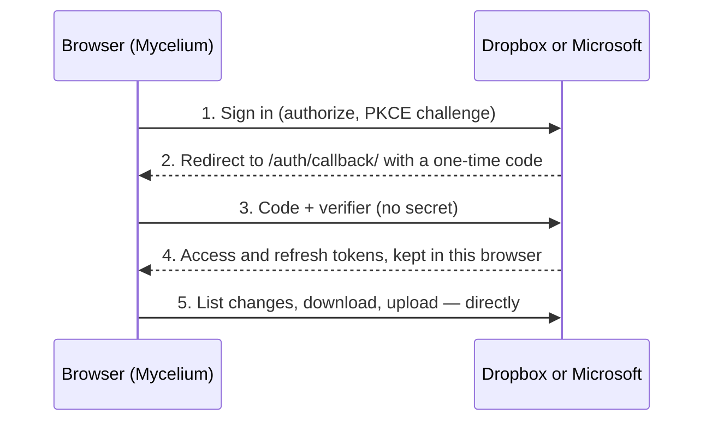

# Setting up cloud storage

Besides git, a vault can live in a folder in **Dropbox**, **OneDrive**, a
**SharePoint** document library, or on a **WebDAV** server such as Nextcloud.
Someone picks the folder that holds their org-roam notes on the Vaults page,
and from then on edits sync on their own between Mycelium (phone or desktop)
and anything else using that folder, such as Emacs on a laptop with the
Dropbox, OneDrive or Nextcloud client.

| Service                 | You register          | Build variable              | Worker needed?              |
| ----------------------- | --------------------- | --------------------------- | --------------------------- |
| Dropbox                 | A Dropbox app         | `PUBLIC_DROPBOX_APP_KEY`    | No                          |
| OneDrive and SharePoint | A Microsoft Entra app | `PUBLIC_ONEDRIVE_CLIENT_ID` | No                          |
| WebDAV / Nextcloud      | Nothing               | None                        | Usually (the `/dav/` relay) |

Dropbox and Microsoft both allow sign-in with PKCE and cross-origin requests,
so the browser talks to them directly: there is no secret, and sign-ins never
pass through your servers. WebDAV servers rarely allow requests from other
websites, so by default they go through the sync worker's relay, which passes
each request on and stores nothing. Everything about a connection (sign-ins,
app passwords) is kept only in each person's browser.

## Dropbox

### Step 1 — Create the Dropbox app

1. Open the [Dropbox App Console](https://www.dropbox.com/developers/apps)
   and select **Create app**.
2. **Choose an API:** _Scoped access_.
3. **Choose the type of access.** This is the one decision that can't be
   changed later:
   - **App folder.** Mycelium can only see `Dropbox/Apps/<your app name>/`.
     It's the safer choice, but people have to move (or keep) their notes in
     that folder.
   - **Full Dropbox.** People can pick any folder, including an org-roam
     folder they already sync with Emacs. Mycelium still only reads and
     writes the folder they pick.

   For people who already keep org-roam in Dropbox, **Full Dropbox** is far
   easier. The sign-in page shows them what the app can access either way.

4. **Name your app**, e.g. `Mycelium Notes`. With App folder access, this
   becomes the folder name in people's Dropbox.
5. Select **Create app**.

### Step 2 — Settings tab

1. **OAuth 2 → Redirect URIs:** add `https://my-celium.org/auth/callback/`
   (with the trailing slash) and select **Add**. For local development, also
   add `http://localhost:4321/mycelium-web/auth/callback/`.
2. **OAuth 2 → Allow public clients (Implicit Grant & PKCE):** leave this on
   **Allow**. Mycelium signs in with PKCE.
3. Note the **App key**, which you'll need in Step 4. The **App secret** isn't
   used; don't put it anywhere.

### Step 3 — Permissions tab

Tick these scopes, then select **Submit** at the bottom:

| Scope                 | Why                             |
| --------------------- | ------------------------------- |
| `account_info.read`   | Show which account is connected |
| `files.metadata.read` | List folders and changes        |
| `files.content.read`  | Download notes                  |
| `files.content.write` | Upload edits                    |

Set the scopes before anyone signs in. If you change them later, people have
to choose **Reconnect Dropbox** (on the Changes page) to get the new ones.

### Step 4 — Add the App key to the build

The App key is public: it ends up in the site's JavaScript, like the other
client IDs.

- **my-celium.org (Cloudflare):** open **Workers & Pages** → `my-celium` →
  **Settings** → **Build** → **Variables and secrets** and add
  `PUBLIC_DROPBOX_APP_KEY` with the App key. Then retry the latest build from
  the **Deployments** tab.
- **GitHub Pages copy:** in the repository, open **Settings → Secrets and
  variables → Actions → Variables**, add `PUBLIC_DROPBOX_APP_KEY`, and run the
  **Deploy to GitHub Pages** workflow. (Sign-in only works on sites whose
  callback URL you added in Step 2.)

Nothing changes on the `mycelium-sync` worker.

### Step 5 — Check it

1. Open `https://my-celium.org/app#/vaults`. A **Dropbox** panel with
   **Connect Dropbox** should appear. If it doesn't, the build didn't get
   `PUBLIC_DROPBOX_APP_KEY`.
2. Connect, open your notes folder, and select **Use \<folder\>**. Mycelium
   downloads the `.org` files and works out the layout, such as a `daily/`
   folder and your TODO keywords.
3. Edit a note. A few seconds later the sidebar reads **Synced**, and the file
   in Dropbox has the change.

### Development status and user limits

New Dropbox apps start in **development** status, which limits how many
accounts can connect. When you need more, use **Apply for production** in the
App Console (Settings tab). Until then, everyone works the same; there's just
a cap.

## OneDrive and SharePoint

One Microsoft app covers personal OneDrive, OneDrive for work or school, and
SharePoint document libraries (for example a Teams channel's files). People
choose **Connect OneDrive** or **Connect SharePoint** on the Vaults page;
SharePoint also asks permission to find their organisation's sites.

### Step 1 — Register the app

1. Open the [Microsoft Entra admin center](https://entra.microsoft.com) →
   **Identity** → **Applications** → **App registrations** → **New
   registration**. (A free personal Microsoft account works: it gets a
   directory of its own.)
2. **Name:** e.g. `Mycelium`. People see it when they sign in.
3. **Supported account types:** _Accounts in any organizational directory
   (any Microsoft Entra ID tenant — multitenant) and personal Microsoft
   accounts_.
4. **Redirect URI:** choose the platform **Single-page application (SPA)**
   and enter `https://my-celium.org/auth/callback/`. It must be the SPA
   platform, not "Web": only SPA redirects may trade sign-in codes from a
   browser.
5. Select **Register**, then copy the **Application (client) ID** from the
   overview page.

Don't create a client secret: Mycelium never uses one.

### Step 2 — API permissions

Open **API permissions** → **Add a permission** → **Microsoft Graph** →
**Delegated permissions**, and add:

| Permission            | Why                                                                      |
| --------------------- | ------------------------------------------------------------------------ |
| `User.Read`           | Show which account is connected (there by default)                       |
| `Files.ReadWrite.All` | Read and write files the person can open, including SharePoint libraries |
| `Sites.Read.All`      | Find SharePoint sites and their libraries (SharePoint only)              |
| `offline_access`      | Keep syncing without signing in each hour                                |

None of these need an administrator to approve them, but each organisation
decides whether its people may approve third-party apps themselves. If
someone sees "Need admin approval", their IT team has to allow the app (they
can approve it for everyone from the same sign-in screen).

### Step 3 — Publisher verification (recommended)

Under **Branding & properties**, add a verified publisher with a Microsoft AI
Cloud Partner Program ID (free to join). Without it, work accounts see the app
as "unverified", and some organisations block unverified apps outright.
Personal accounts aren't affected.

### Step 4 — Add the client ID to the build

Add `PUBLIC_ONEDRIVE_CLIENT_ID` with the Application (client) ID, the same way
as Dropbox's key: for my-celium.org under `my-celium` → **Settings** →
**Build** → **Variables and secrets**, then retry the latest build.

### Step 5 — Check it

1. On the Vaults page, **Connect OneDrive** and **Connect SharePoint** should
   appear.
2. Connect OneDrive, pick **My files**, open your notes folder and choose
   **Use \<folder\>**.
3. For SharePoint: Connect SharePoint, search for the site, pick its document
   library (often "Documents"), then the folder.

## WebDAV and Nextcloud

Nothing to register. On the Vaults page, **Connect WebDAV / Nextcloud** asks
for:

- **Server address.** For Nextcloud or ownCloud, the server's address
  (`https://cloud.example.com`) is enough. For anything else, paste the full
  WebDAV address (Synology: `https://nas.example.com:5006/`; Koofr:
  `https://app.koofr.net/dav/Koofr/`; Fastmail:
  `https://myfiles.fastmail.com/`).
- **User name and app password.** Use an app password, not your main one:
  Nextcloud → Settings → Security → Devices & sessions → _Create new app
  password_. It's kept only in this browser and sent only to your server
  (through the relay, when it's on).
- **Use the sync relay** (on by default). Most servers don't accept requests
  from other websites (CORS). If yours is configured to allow
  `https://my-celium.org`, turn the relay off to connect directly.

### The relay

The relay is part of the `mycelium-sync` worker, at `/dav/<host>/<path>`. It
redeploys with the worker, so after merging this change, make sure the worker
has rebuilt (**Workers & Pages** → `mycelium-sync` → **Deployments**). It is
deliberately narrow:

- only WebDAV file requests (`PROPFIND`, `GET`, `PUT`, `DELETE`, `MKCOL`), and
  only from this site's origins (`ALLOWED_ORIGINS`);
- only HTTPS servers named by host name: no IP addresses, `localhost`, or
  `.local`/`.internal` names, so it can't reach private networks;
- only requests that carry a user name and password, and at most 20 MB;
- redirects aren't followed, so a password can't be forwarded elsewhere;
- nothing is stored or logged.

To limit it to your own servers, add a worker variable `DAV_HOSTS` with a
comma-separated list of host names (e.g. `cloud.example.com`). Your WebDAV
password passes through the relay in memory. If you'd rather it didn't, allow
CORS on your server and turn the relay off.

A server on your home network (`192.168.…`, `nas.local`) can't be reached from
the relay. Use its public address, or open the app from a device on that
network with the relay off and CORS allowed.

## How sync behaves

- **Offline first.** Notes are kept in the browser, so a cloud vault opens
  and edits without a connection. Edits made offline upload when the
  connection comes back.
- **When it syncs:**
  - a few seconds after you stop editing;
  - when you open or return to the app, and when you reconnect;
  - while the app is open and on screen: every minute at first, then less
    often while nothing changes (2, 4, then every 5 minutes). Any edit, change
    from elsewhere, or return to the app goes back to every minute;
  - when you select **Sync now** in the sidebar or on Changes.

  Browsers don't let web apps sync in the background, so changes from other
  devices arrive the next time Mycelium is open. Nothing runs while the app
  is closed or in the background, so it doesn't drain the battery.

- **Data use.** A check that finds nothing new is about 1–2 KB for Dropbox and
  OneDrive. Edits upload the whole file, usually a few KB. Connecting
  downloads the whole vault once.
  - **WebDAV** has no change feed, so each check lists the folder. Nextcloud
    and ownCloud only list folders that changed, and servers that allow it
    answer with the whole tree in one request; both are checked every 2
    minutes. Other servers are listed folder by folder, about 300 bytes per
    file, every 5 minutes.
  - **Data Saver.** When the phone or browser asks to save data (Chrome on
    Android reports this; Safari doesn't), checks start at every 10 minutes and
    stretch to 15. Edits still upload a few seconds after you stop typing.

- **Sign-in lifetimes.** Dropbox sign-ins last until revoked. Microsoft limits
  sign-ins made in web apps to 24 hours, renewed each time they're used, so
  after a day or more away Mycelium may ask you to **Reconnect** (one tap, on
  the Changes page). WebDAV app passwords last until you revoke them.

- **Edits on two devices are merged.** Each file remembers the version both
  sides last agreed on, and edits are merged line by line against it, like
  git. Two devices ticking off different tasks in the same list merge
  cleanly. Only edits to the same lines ask you to choose a version.
- **Nothing is overwritten blindly.** Every upload says which version it's
  based on (a Dropbox revision, or the file's ETag for OneDrive and WebDAV).
  If the service has a newer one, the upload is refused, Mycelium merges the
  newer version and then uploads.
- **Only `.org` files** are synced; other files and hidden folders are left
  alone. Removing a cloud vault from Mycelium deletes only the browser's
  copy, never anything in the service.

## Troubleshooting

| Symptom                                      | Fix                                                                                                                         |
| -------------------------------------------- | --------------------------------------------------------------------------------------------------------------------------- |
| No **Connect Dropbox** button                | `PUBLIC_DROPBOX_APP_KEY` isn't in the build; add it and rebuild (Step 4).                                                   |
| Dropbox says "Invalid redirect_uri"          | The callback URL in Step 2 must match exactly, including `https://` and the trailing slash.                                 |
| Dropbox says the app is missing a permission | Tick the scopes in Step 3, **Submit**, then reconnect.                                                                      |
| "Dropbox signed you out"                     | The person revoked access, or the refresh token expired. Select **Reconnect Dropbox** on the Changes page.                  |
| A folder you expect isn't listed             | With **App folder** access, only `Dropbox/Apps/<app name>/` is visible. Move the notes there, or create a Full Dropbox app. |
