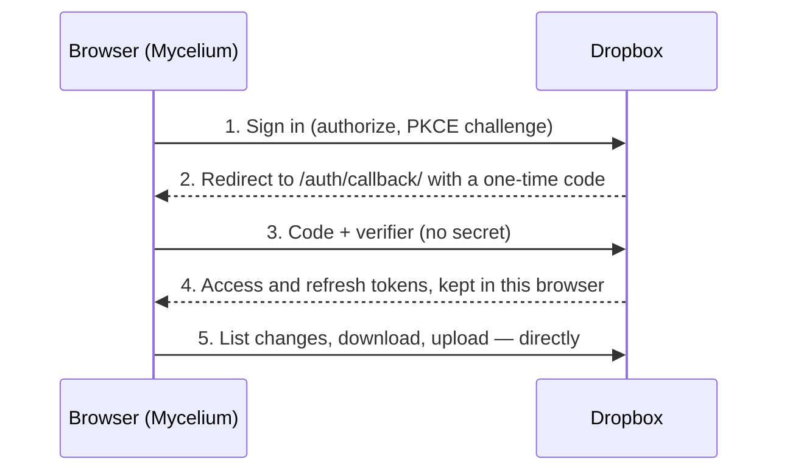

# Setting up Dropbox

With Dropbox set up, the Vaults page shows **Connect Dropbox**. Someone signs
in, picks the folder that holds their org-roam notes, and from then on edits
sync on their own between Mycelium (phone or desktop) and anything else using
that folder, such as Emacs on a laptop with the Dropbox client.

You register one Dropbox app, then put its **App key** into the site build.
There is no secret and no worker involved: Dropbox supports PKCE sign-in and
cross-origin requests, so the browser talks to Dropbox directly. Tokens are
kept only in each person's browser and go only to Dropbox.

## Step 1 — Create the Dropbox app

1. Open the [Dropbox App Console](https://www.dropbox.com/developers/apps)
   and select **Create app**.
2. **Choose an API:** _Scoped access_.
3. **Choose the type of access.** This is the one decision that can't be
   changed later:
   - **App folder.** Mycelium can only see `Dropbox/Apps/<your app name>/`.
     It's the safer choice, but people have to move (or keep) their notes in
     that folder.
   - **Full Dropbox.** People can pick any folder, including an org-roam
     folder they already sync with Emacs. Mycelium still only reads and
     writes the folder they pick.

   For people who already keep org-roam in Dropbox, **Full Dropbox** is far
   easier. The sign-in page shows them what the app can access either way.

4. **Name your app**, e.g. `Mycelium Notes`. With App folder access, this
   becomes the folder name in people's Dropbox.
5. Select **Create app**.

## Step 2 — Settings tab

1. **OAuth 2 → Redirect URIs:** add `https://my-celium.org/auth/callback/`
   (with the trailing slash) and select **Add**. For local development, also
   add `http://localhost:4321/mycelium-web/auth/callback/`.
2. **OAuth 2 → Allow public clients (Implicit Grant & PKCE):** leave this on
   **Allow**. Mycelium signs in with PKCE.
3. Note the **App key**, which you'll need in Step 4. The **App secret** isn't
   used; don't put it anywhere.

## Step 3 — Permissions tab

Tick these scopes, then select **Submit** at the bottom:

| Scope                 | Why                             |
| --------------------- | ------------------------------- |
| `account_info.read`   | Show which account is connected |
| `files.metadata.read` | List folders and changes        |
| `files.content.read`  | Download notes                  |
| `files.content.write` | Upload edits                    |

Set the scopes before anyone signs in. If you change them later, people have
to choose **Reconnect Dropbox** (on the Changes page) to get the new ones.

## Step 4 — Add the App key to the build

The App key is public: it ends up in the site's JavaScript, like the other
client IDs.

- **my-celium.org (Cloudflare):** open **Workers & Pages** → `my-celium` →
  **Settings** → **Build** → **Variables and secrets** and add
  `PUBLIC_DROPBOX_APP_KEY` with the App key. Then retry the latest build from
  the **Deployments** tab.
- **GitHub Pages copy:** in the repository, open **Settings → Secrets and
  variables → Actions → Variables**, add `PUBLIC_DROPBOX_APP_KEY`, and run the
  **Deploy to GitHub Pages** workflow. (Sign-in only works on sites whose
  callback URL you added in Step 2.)

Nothing changes on the `mycelium-sync` worker.

## Step 5 — Check it

1. Open `https://my-celium.org/app#/vaults`. A **Dropbox** panel with
   **Connect Dropbox** should appear. If it doesn't, the build didn't get
   `PUBLIC_DROPBOX_APP_KEY`.
2. Connect, open your notes folder, and select **Use \<folder\>**. Mycelium
   downloads the `.org` files and works out the layout, such as a `daily/`
   folder and your TODO keywords.
3. Edit a note. A few seconds later the sidebar reads **Synced**, and the file
   in Dropbox has the change.

## Development status and user limits

New Dropbox apps start in **development** status, which limits how many
accounts can connect. When you need more, use **Apply for production** in the
App Console (Settings tab). Until then, everyone works the same; there's just
a cap.

## How sync behaves

- **Offline first.** Notes are kept in the browser, so a Dropbox vault opens
  and edits without a connection. Edits made offline upload when the
  connection comes back.
- **When it syncs:**
  - a few seconds after you stop editing;
  - when you open or return to the app, and when you reconnect;
  - every minute while the app is open;
  - when you select **Sync now** in the sidebar or on Changes.

  Browsers don't let web apps sync in the background, so changes from other
  devices arrive the next time Mycelium is open.

- **Edits on two devices are merged.** Each file remembers the version both
  sides last agreed on, and edits are merged line by line against it, like
  git. Two devices ticking off different tasks in the same list merge
  cleanly. Only edits to the same lines ask you to choose a version.
- **Nothing is overwritten blindly.** Every upload says which Dropbox revision
  it's based on. If Dropbox has a newer one, the upload is refused, Mycelium
  merges the newer version and then uploads.
- **Only `.org` files** are synced; other files and hidden folders are left
  alone. Removing a Dropbox vault from Mycelium deletes only the browser's
  copy, never anything in Dropbox.

## Troubleshooting

| Symptom                                      | Fix                                                                                                                         |
| -------------------------------------------- | --------------------------------------------------------------------------------------------------------------------------- |
| No **Connect Dropbox** button                | `PUBLIC_DROPBOX_APP_KEY` isn't in the build; add it and rebuild (Step 4).                                                   |
| Dropbox says "Invalid redirect_uri"          | The callback URL in Step 2 must match exactly, including `https://` and the trailing slash.                                 |
| Dropbox says the app is missing a permission | Tick the scopes in Step 3, **Submit**, then reconnect.                                                                      |
| "Dropbox signed you out"                     | The person revoked access, or the refresh token expired. Select **Reconnect Dropbox** on the Changes page.                  |
| A folder you expect isn't listed             | With **App folder** access, only `Dropbox/Apps/<app name>/` is visible. Move the notes there, or create a Full Dropbox app. |
