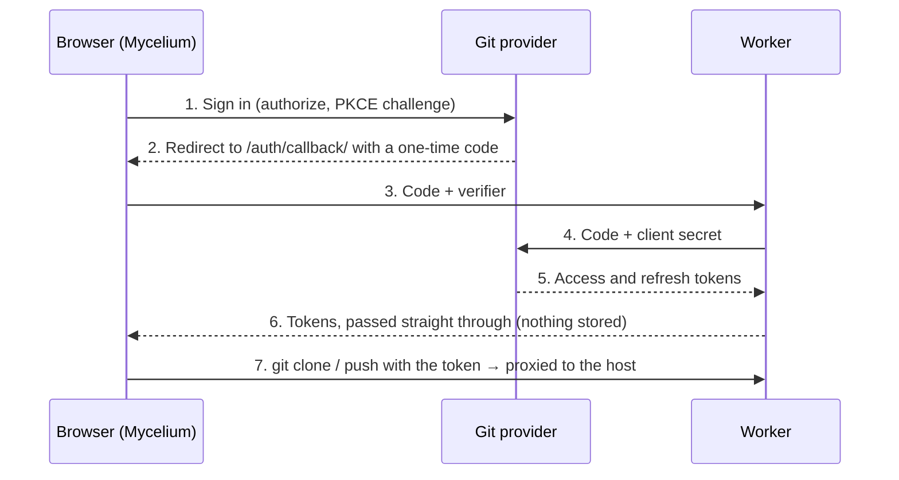

# Setting up git providers

You register four things once — a Cloudflare worker, a GitHub App, a GitLab
application and a Bitbucket OAuth consumer — then put their IDs into the
worker and into the site's build variables. After that, anyone can tap
**Sign in with GitHub/GitLab/Bitbucket** on the Vaults page instead of
creating an access token.

Nothing about your users is stored on your side. The worker swaps a one-time
sign-in code for a token and hands it straight back to the browser, and it
proxies git traffic, which browsers cannot send to git hosts directly.

| Where                | What you create                            | Public values (safe in the site build) | Secrets (worker only) |
| -------------------- | ------------------------------------------ | -------------------------------------- | --------------------- |
| Cloudflare           | Worker `mycelium-sync` (dashboard or CLI)  | Worker URL                             | —                     |
| GitHub               | GitHub App                                 | Client ID, app slug                    | Client secret         |
| GitLab               | OAuth application (non-confidential, PKCE) | Application ID                         | None needed           |
| Bitbucket            | OAuth consumer                             | Key                                    | Secret                |
| GitHub repo settings | Actions variables for the Pages build      | All of the public values above         | —                     |



The client secret never leaves the worker, and tokens never leave the browser
except to reach the git host.

Every provider gets the same callback URL:
`https://my-celium.org/auth/callback/`. If the site moves to another domain,
update it in all three providers and in the worker's `ALLOWED_ORIGINS`. (A
copy also builds to `https://jackhale98.github.io/mycelium-web/`; sign-in is
set up for my-celium.org only, while pasted access tokens work on both.)

Until these are registered the site still works: people paste an access token
on the Vaults page, as described in Step 6.

## Step 0 — Host the site at my-celium.org

The site is a static build served by Cloudflare as a Worker with static
assets; `wrangler.jsonc` at the repository root tells Cloudflare to upload
`dist/`. On Cloudflare the build serves from the domain's root automatically.

1. In the Cloudflare dashboard, **Workers & Pages → Create application →
   Import a repository**, and pick `jackhale98/mycelium-web`.
2. Fill in:

   | Field          | Value                                               |
   | -------------- | --------------------------------------------------- |
   | Project name   | `my-celium` (must match `name` in `wrangler.jsonc`) |
   | Build command  | `npm run build`                                     |
   | Deploy command | `npx wrangler deploy`                               |
   | Root directory | Leave empty (the repository root)                   |

3. Select **Deploy**. The site appears at
   `https://my-celium.<your-subdomain>.workers.dev`.
4. Attach the domain: open the worker → **Settings → Domains & Routes → Add →
   Custom domain**, enter `my-celium.org`, and repeat for `www.my-celium.org`
   if you want it. Cloudflare creates the DNS records and certificate.
5. Keep Cloudflare features that inject scripts turned off for the domain
   (Rocket Loader, Email Address Obfuscation, Web Analytics auto-injection,
   Zaraz): the site's Content Security Policy blocks scripts it didn't ship.
6. Later, once the sign-in values exist (Steps 2–4), add them as **build**
   variables: worker → **Settings → Build → Variables and secrets**, with the
   names from Step 5 (`PUBLIC_GIT_PROXY`, `PUBLIC_GITHUB_CLIENT_ID`, …), then
   retry the latest build. These are build-time values, unlike the sync
   worker's secrets.

## Step 1 — Deploy the Cloudflare worker

The worker is the only server piece. It runs on Cloudflare's free plan
(100,000 requests a day, roughly 20,000 syncs) and takes about five minutes.
Do this first: the other steps need its URL.

You can create it entirely from the Cloudflare dashboard (Option A, no
terminal needed) or with Wrangler on your computer (Option B).

### Option A — From the Cloudflare dashboard (recommended)

Cloudflare builds the worker straight from the `worker` folder of this
repository and redeploys it whenever that folder changes on `main`.

1. Create a free account at [dash.cloudflare.com](https://dash.cloudflare.com/sign-up)
   and sign in.
2. Open **Workers & Pages** (under **Compute** in the sidebar) and select
   **Create application**.
3. Choose **Import a repository** (the GitHub option). If asked, connect your
   GitHub account and allow Cloudflare access to `jackhale98/mycelium-web`
   (you can limit it to just this repository).
4. Select the `mycelium-web` repository and fill in the project settings:

   | Field                 | Value                                                          |
   | --------------------- | -------------------------------------------------------------- |
   | Project name          | `mycelium-sync` (must match `name` in `worker/wrangler.jsonc`) |
   | Production branch     | `main`                                                         |
   | Build command         | Leave empty                                                    |
   | Deploy command        | `npx wrangler@4 deploy`                                        |
   | Root directory / Path | `worker` (under **Advanced settings** if it's collapsed)       |
   | Build variables       | None                                                           |

5. Select **Save and Deploy** (or **Create and deploy**). The first build takes
   a minute or two; you can watch its log on the worker's **Deployments** tab.
6. When it finishes, the worker's page shows its URL, for example
   `https://mycelium-sync.<your-subdomain>.workers.dev`. Keep it for Step 5.
7. Only rebuild when the worker changes: open the worker → **Settings** →
   **Build** → **Build watch paths**, and set **Include paths** to `worker/*`.
   Otherwise every push to `main` (notes app changes included) redeploys the
   worker. That's harmless, just unnecessary.

**Allowed origins live in the repository, not the dashboard.**
`ALLOWED_ORIGINS` is set in `worker/wrangler.jsonc`, and every build applies the
file's value, so a variable edited in the dashboard would be overwritten on the
next deploy. It lists `https://my-celium.org`, `https://www.my-celium.org`,
`https://jackhale98.github.io` (origins, no path) and `http://localhost:4321`
for local development. To change it, edit
the file on GitHub (open it, select the pencil icon, commit to `main`) and
Cloudflare redeploys by itself.

### Option B — With Wrangler from a terminal

In a local clone of `mycelium-web`, deploy from the `worker` folder:

```sh
cd worker
npx wrangler login
npx wrangler deploy
```

Wrangler prints the worker's URL. Check `ALLOWED_ORIGINS` in
`worker/wrangler.jsonc` as described above, and deploy again if you changed it.

If you'd rather deploy from GitHub Actions, add a `CLOUDFLARE_API_TOKEN`
repository secret (Cloudflare token template "Edit Cloudflare Workers") and run
the **Deploy worker** workflow in the Actions tab. Use only one of Option A or
the Actions workflow, so two deploy paths don't race each other.

### Optional: give the worker its own subdomain

Open the `mycelium-sync` worker → **Settings → Domains & Routes → Add →
Custom domain** and enter `sync.my-celium.org`. Use that as the worker URL in
Step 5. With the worker on your own zone you can also add a rate-limiting rule
(**Security → WAF → Rate limiting rules**, for example 300 requests per minute
per IP on `sync.my-celium.org`).

### Check it

Open
`https://<worker-url>/github.com/x/y.git/info/refs?service=git-upload-pack` in
a browser tab. You should see "Origin not allowed": the worker refuses
anything that isn't the site, which is what you want.

Rate-limiting rules need the worker on your own domain (see above); on a
`workers.dev` address, skip them.

## Step 2 — Register the GitHub App

Use a GitHub App rather than an OAuth App: people choose exactly which
repositories it may touch, and its sign-in tokens expire after 8 hours and
refresh automatically for about 6 months.

1. Go to [GitHub → Settings → Developer settings → GitHub Apps → New GitHub App](https://github.com/settings/apps/new).
2. Fill in the form:

   | Field                                                  | Value                                                       |
   | ------------------------------------------------------ | ----------------------------------------------------------- |
   | GitHub App name                                        | `Mycelium Notes` (must be unique on GitHub; any name works) |
   | Homepage URL                                           | `https://my-celium.org/`                                    |
   | Callback URL                                           | `https://my-celium.org/auth/callback/`                      |
   | Expire user authorization tokens                       | Checked                                                     |
   | Request user authorization (OAuth) during installation | Checked                                                     |
   | Enable Device Flow                                     | Unchecked                                                   |
   | Webhook → Active                                       | Unchecked (the app needs no events)                         |
   | Repository permissions → Contents                      | Read and write                                              |
   | Repository permissions → Metadata                      | Read-only (GitHub sets this automatically)                  |
   | All other permissions                                  | No access                                                   |
   | Where can this GitHub App be installed?                | Any account (so others can use your site)                   |

3. Click **Create GitHub App**.
4. On the app's page, note the **Client ID** (starts with `Iv`).
5. Click **Generate a new client secret** and copy it now; GitHub shows it only once.
6. Note the app's **slug**: the last part of its public URL,
   `https://github.com/apps/<slug>`. The site uses it to send people to
   "Install on repositories".

You don't need a private key: the app never acts on its own, only on behalf of
the signed-in person.

When someone signs in for the first time, GitHub asks which repositories to
install the app on. They can add or remove repositories later under
GitHub → Settings → Applications.

## Step 3 — Register the GitLab application

GitLab supports sign-in without a client secret (PKCE), so its application is
created as non-confidential and no secret goes into the worker.

1. Go to [GitLab → Edit profile → Applications → Add new application](https://gitlab.com/-/user_settings/applications).
   (A group or self-managed instance has the same form under its settings.)
2. Fill in the form:

   | Field        | Value                                                          |
   | ------------ | -------------------------------------------------------------- |
   | Name         | `Mycelium`                                                     |
   | Redirect URI | `https://my-celium.org/auth/callback/`                         |
   | Confidential | Unchecked                                                      |
   | Scopes       | `read_user`, `read_api`, `read_repository`, `write_repository` |

3. Click **Save application** and note the **Application ID**. You can ignore the secret.

What the scopes are for: `read_user` fills in the commit name and email,
`read_api` lists the person's projects in the repository picker, and the two
repository scopes let git clone and push over HTTPS. GitLab access tokens last
2 hours and refresh automatically.

## Step 4 — Create the Bitbucket OAuth consumer

Bitbucket needs its secret for every token exchange and refresh, so the secret
lives in the worker.

OAuth consumers belong to a **workspace**, not to your personal account
settings, and only workspace admins see them. In a personal workspace, only
its owner sees them.

1. In Bitbucket, select your avatar (top right) and pick the workspace under
   **Recent workspaces** (or **All workspaces**).
2. Open the workspace's settings: select **Settings** in the left sidebar (or the
   **Settings** cog in the top bar, then **Workspace settings**). Don't use
   **Personal settings**: it has no OAuth consumers.
3. In the settings sidebar, under **Apps and features**, select
   **OAuth consumers**, then **Add consumer**.

   Can't see **Apps and features**? You aren't an admin of that workspace, or
   it's someone else's personal workspace. Use a workspace you own.

4. Fill in the form:

   | Field                      | Value                                             |
   | -------------------------- | ------------------------------------------------- |
   | Name                       | `Mycelium`                                        |
   | Callback URL               | `https://my-celium.org/auth/callback/`            |
   | This is a private consumer | Unchecked, if shown (so other people can sign in) |
   | Permissions → Account      | Read                                              |
   | Permissions → Repositories | Read and Write                                    |

5. Select **Save**, then select the consumer's name in the list to see its
   **Key** (the client ID) and **Secret**.

Bitbucket access tokens last about 2 hours and refresh through the worker. Git
uses them with the username `x-token-auth`; the site handles that.

**Access is not per repository.** A Bitbucket OAuth consumer can't be limited
to chosen repositories: signing in grants read and write to every repository
the person can access. To limit access to one repository, skip sign-in and
paste a **repository access token** instead (the repository's **Repository
settings → Security → Access tokens**, with Repository Read and Write; check
your Bitbucket plan includes them, as workspace and project tokens are
Premium-only).

Bitbucket sign-in is optional: without a consumer, people paste an Atlassian
API token or a repository access token instead (Step 6).

Sources: Atlassian's [Use OAuth on Bitbucket Cloud](https://support.atlassian.com/bitbucket-cloud/docs/use-oauth-on-bitbucket-cloud/)
and [Apps and features settings are missing for admins in personal workspace](https://support.atlassian.com/bitbucket-cloud/kb/apps-and-features-settings-are-missing-for-admins-in-personal-workspace/).

## Step 5 — Wire it up

Secrets go into the worker; public IDs go into the site's build. A provider
you skip simply doesn't get a sign-in button.

**Worker secrets.** Add only the ones for the providers you registered.

_In the dashboard:_ open **Workers & Pages** → `mycelium-sync` → **Settings**
→ **Variables and Secrets** → **Add**. For each row below, choose type
**Secret**, enter the name and paste the value, then select **Deploy**. Secrets
added this way stay in place across later builds.

| Name                      | Value                     |
| ------------------------- | ------------------------- |
| `GITHUB_CLIENT_ID`        | GitHub App client ID      |
| `GITHUB_CLIENT_SECRET`    | GitHub App client secret  |
| `GITLAB_CLIENT_ID`        | GitLab application ID     |
| `BITBUCKET_CLIENT_ID`     | Bitbucket consumer key    |
| `BITBUCKET_CLIENT_SECRET` | Bitbucket consumer secret |

Don't use **Build** → **Variables and secrets** for these: those are visible
only while the worker is being built, not when it runs.

_With Wrangler:_ from the `worker` folder, run each command and paste the
value when asked:

```sh
npx wrangler secret put GITHUB_CLIENT_ID
npx wrangler secret put GITHUB_CLIENT_SECRET
npx wrangler secret put GITLAB_CLIENT_ID
npx wrangler secret put BITBUCKET_CLIENT_ID
npx wrangler secret put BITBUCKET_CLIENT_SECRET
```

Either way, secrets take effect right away; no rebuild is needed.

**Site build variables.** For my-celium.org, add them in Cloudflare as in
Step 0 item 6. For the GitHub Pages copy, in `jackhale98/mycelium-web` on GitHub, open
**Settings → Secrets and variables → Actions → Variables** and add:

| Variable                     | Value                      |
| ---------------------------- | -------------------------- |
| `PUBLIC_GIT_PROXY`           | The worker URL from Step 1 |
| `PUBLIC_GITHUB_CLIENT_ID`    | GitHub App client ID       |
| `PUBLIC_GITHUB_APP_SLUG`     | GitHub App slug            |
| `PUBLIC_GITLAB_CLIENT_ID`    | GitLab application ID      |
| `PUBLIC_BITBUCKET_CLIENT_ID` | Bitbucket consumer key     |

Use **Variables**, not Secrets: these values end up in the published
JavaScript anyway, and the build reads them as variables.

**Redeploy.** On Cloudflare, retry the latest build of `my-celium` (its
**Deployments** tab); for the GitHub Pages copy, open **Actions → Deploy to
GitHub Pages → Run workflow** on `main`. Vaults you've already added keep their old proxy; change it under
Settings → Sync proxy in the app.

## Step 6 — Verify, troubleshoot and fall back

**Verify.** Open the site, go to **Vaults**, and you should see a
"Sign in with…" button for each provider you configured.

- [ ] Sign in with GitHub, install the app on one notes repository, pick it, and it clones
- [ ] Edit a note, commit with a message, and push; the commit appears on GitHub under your name
- [ ] Repeat for GitLab and Bitbucket if you registered them

**Troubleshooting**

| Symptom                                    | Likely cause                                                 | Fix                                                                                                                |
| ------------------------------------------ | ------------------------------------------------------------ | ------------------------------------------------------------------------------------------------------------------ |
| No sign-in buttons                         | Build variables missing, or the site wasn't redeployed       | Check the variable names in Step 5 and re-run the Pages deploy                                                     |
| Provider says the redirect URI is invalid  | Callback URL differs by a character (trailing slash, `http`) | Use exactly `https://my-celium.org/auth/callback/`                                                                 |
| "Origin not allowed"                       | `ALLOWED_ORIGINS` doesn't list the site's origin             | Add it in `worker/wrangler.jsonc` on `main` (Option A rebuilds by itself; with Option B run `npx wrangler deploy`) |
| "sign-in is not configured on this worker" | A worker secret is missing                                   | Add it under the worker's **Settings → Variables and Secrets**, or `npx wrangler secret put …`                     |
| Dashboard build fails: name mismatch       | Project name isn't `mycelium-sync`                           | Rename the worker to match `name` in `worker/wrangler.jsonc`, or change the file                                   |
| Dashboard build fails: no Wrangler config  | Root directory isn't `worker`                                | Worker → **Settings → Build** → set the root directory to `worker` and retry                                       |
| GitHub repository picker is empty          | The app isn't installed on any repository yet                | Use "Install on repositories" on the Vaults page                                                                   |
| Push rejected after a while                | Token expired and couldn't refresh                           | Sign out and back in on the Vaults page                                                                            |

**Security notes**

- Tokens are kept only in the visitor's browser and travel to the git host
  through your worker. The worker stores nothing and has logging off.
- Each provider grants only repository read/write (and, on GitLab, read access
  to the profile and project list).
- To revoke everything at once, regenerate the GitHub client secret, the
  Bitbucket secret, or delete the GitLab application.

**Fallback: access tokens.** Sign-in is optional. On the Vaults page anyone
can paste a personal access token instead: a fine-grained GitHub token with
"Contents: Read and write" on one repository, a GitLab token with
`read_repository` and `write_repository`, or an Atlassian API token for
Bitbucket with `read:repository:bitbucket` and `write:repository:bitbucket`
(created at [id.atlassian.com → Security → API tokens](https://id.atlassian.com/manage-profile/security/api-tokens);
leave the username blank), or a Bitbucket repository access token for access to
one repository only. This is also the way to use self-hosted GitLab or Gitea.
