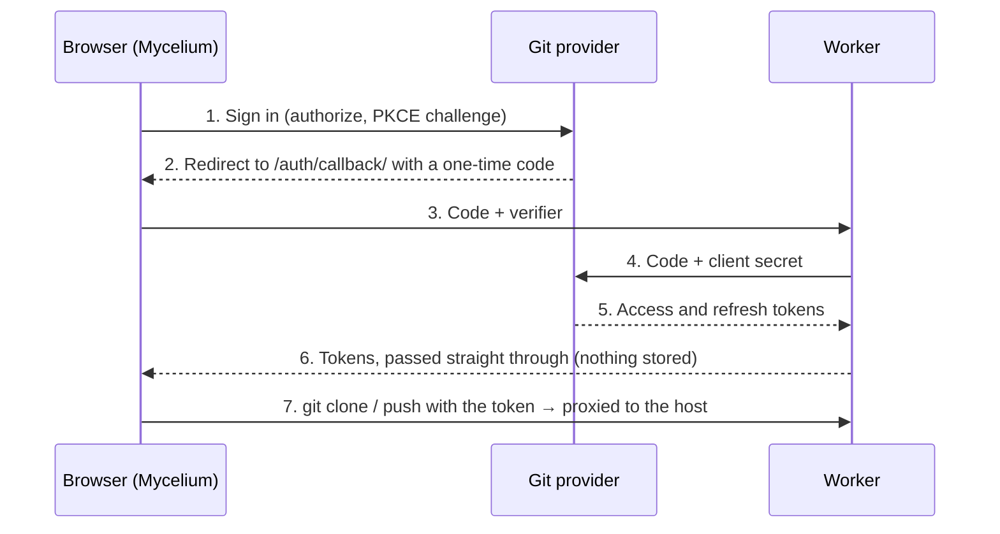

# Setting up git providers

You register four things once — a Cloudflare worker, a GitHub App, a GitLab
application and a Bitbucket OAuth consumer — then put their IDs into the
worker and into the site's build variables. After that, anyone can tap
**Sign in with GitHub/GitLab/Bitbucket** on the Vaults page instead of
creating an access token.

Nothing about your users is stored on your side. The worker swaps a one-time
sign-in code for a token and hands it straight back to the browser, and it
proxies git traffic, which browsers cannot send to git hosts directly.

| Where                | What you create                            | Public values (safe in the site build) | Secrets (worker only) |
| -------------------- | ------------------------------------------ | -------------------------------------- | --------------------- |
| Cloudflare           | Worker `mycelium-sync`                     | Worker URL                             | —                     |
| GitHub               | GitHub App                                 | Client ID, app slug                    | Client secret         |
| GitLab               | OAuth application (non-confidential, PKCE) | Application ID                         | None needed           |
| Bitbucket            | OAuth consumer                             | Key                                    | Secret                |
| GitHub repo settings | Actions variables for the Pages build      | All of the public values above         | —                     |



The client secret never leaves the worker, and tokens never leave the browser
except to reach the git host.

Every provider gets the same callback URL:
`https://jackhale98.github.io/mycelium-web/auth/callback/`. If you later move
the site to a custom domain, update it in all three providers and in the
worker's `ALLOWED_ORIGINS`.

Until these are registered the site still works: people paste an access token
on the Vaults page, as described in Step 6.

## Step 1 — Deploy the Cloudflare worker

The worker is the only server piece. It runs on Cloudflare's free plan
(100,000 requests a day, roughly 20,000 syncs) and takes about five minutes.
Do this first: the other steps need its URL.

1. Create a free account at [dash.cloudflare.com](https://dash.cloudflare.com/sign-up).
2. In a local clone of `mycelium-web`, deploy from the `worker` folder:
   ```sh
   cd worker
   npx wrangler login
   npx wrangler deploy
   ```
3. Wrangler prints the worker's URL, for example
   `https://mycelium-sync.<your-subdomain>.workers.dev`. Keep it for Step 5.
4. Check `ALLOWED_ORIGINS` in `worker/wrangler.toml`. It should list
   `https://jackhale98.github.io` (the site's origin, no path) and
   `http://localhost:4321` for local development. Deploy again if you changed it.
5. Recommended: in the Cloudflare dashboard, open the worker and add a
   rate-limiting rule (for example 300 requests per minute per IP).

To check it, open
`https://<worker-url>/github.com/x/y.git/info/refs?service=git-upload-pack` in
a browser tab. You should see "Origin not allowed": the worker refuses
anything that isn't the site, which is what you want.

If you'd rather deploy from GitHub, add a `CLOUDFLARE_API_TOKEN` repository
secret (Cloudflare token template "Edit Cloudflare Workers") and run the
**Deploy worker** workflow in the Actions tab.

## Step 2 — Register the GitHub App

Use a GitHub App rather than an OAuth App: people choose exactly which
repositories it may touch, and its sign-in tokens expire after 8 hours and
refresh automatically for about 6 months.

1. Go to [GitHub → Settings → Developer settings → GitHub Apps → New GitHub App](https://github.com/settings/apps/new).
2. Fill in the form:

   | Field                                                  | Value                                                       |
   | ------------------------------------------------------ | ----------------------------------------------------------- |
   | GitHub App name                                        | `Mycelium Notes` (must be unique on GitHub; any name works) |
   | Homepage URL                                           | `https://jackhale98.github.io/mycelium-web/`                |
   | Callback URL                                           | `https://jackhale98.github.io/mycelium-web/auth/callback/`  |
   | Expire user authorization tokens                       | Checked                                                     |
   | Request user authorization (OAuth) during installation | Checked                                                     |
   | Enable Device Flow                                     | Unchecked                                                   |
   | Webhook → Active                                       | Unchecked (the app needs no events)                         |
   | Repository permissions → Contents                      | Read and write                                              |
   | Repository permissions → Metadata                      | Read-only (GitHub sets this automatically)                  |
   | All other permissions                                  | No access                                                   |
   | Where can this GitHub App be installed?                | Any account (so others can use your site)                   |

3. Click **Create GitHub App**.
4. On the app's page, note the **Client ID** (starts with `Iv`).
5. Click **Generate a new client secret** and copy it now; GitHub shows it only once.
6. Note the app's **slug**: the last part of its public URL,
   `https://github.com/apps/<slug>`. The site uses it to send people to
   "Install on repositories".

You don't need a private key: the app never acts on its own, only on behalf of
the signed-in person.

When someone signs in for the first time, GitHub asks which repositories to
install the app on. They can add or remove repositories later under
GitHub → Settings → Applications.

## Step 3 — Register the GitLab application

GitLab supports sign-in without a client secret (PKCE), so its application is
created as non-confidential and no secret goes into the worker.

1. Go to [GitLab → Edit profile → Applications → Add new application](https://gitlab.com/-/user_settings/applications).
   (A group or self-managed instance has the same form under its settings.)
2. Fill in the form:

   | Field        | Value                                                          |
   | ------------ | -------------------------------------------------------------- |
   | Name         | `Mycelium`                                                     |
   | Redirect URI | `https://jackhale98.github.io/mycelium-web/auth/callback/`     |
   | Confidential | Unchecked                                                      |
   | Scopes       | `read_user`, `read_api`, `read_repository`, `write_repository` |

3. Click **Save application** and note the **Application ID**. You can ignore the secret.

What the scopes are for: `read_user` fills in the commit name and email,
`read_api` lists the person's projects in the repository picker, and the two
repository scopes let git clone and push over HTTPS. GitLab access tokens last
2 hours and refresh automatically.

## Step 4 — Create the Bitbucket OAuth consumer

Bitbucket needs its secret for every token exchange and refresh, so the secret
lives in the worker.

1. In Bitbucket, open the workspace you'll register it under, then
   **Settings → Apps and features → OAuth consumers → Add consumer**.
2. Fill in the form:

   | Field                      | Value                                                      |
   | -------------------------- | ---------------------------------------------------------- |
   | Name                       | `Mycelium`                                                 |
   | Callback URL               | `https://jackhale98.github.io/mycelium-web/auth/callback/` |
   | This is a private consumer | Unchecked (so other people can sign in)                    |
   | Permissions → Account      | Read                                                       |
   | Permissions → Repositories | Read and Write                                             |

3. Click **Save**, then expand the consumer to see its **Key** (the client ID) and **Secret**.

Bitbucket access tokens last about 2 hours and refresh through the worker. Git
uses them with the username `x-token-auth`; the site handles that.

## Step 5 — Wire it up

Secrets go into the worker; public IDs go into the site's build. A provider
you skip simply doesn't get a sign-in button.

**Worker secrets.** From the `worker` folder, run each command and paste the
value when asked:

```sh
npx wrangler secret put GITHUB_CLIENT_ID
npx wrangler secret put GITHUB_CLIENT_SECRET
npx wrangler secret put GITLAB_CLIENT_ID
npx wrangler secret put BITBUCKET_CLIENT_ID
npx wrangler secret put BITBUCKET_CLIENT_SECRET
```

Secrets take effect immediately; no redeploy is needed.

**Site build variables.** In `jackhale98/mycelium-web` on GitHub, open
**Settings → Secrets and variables → Actions → Variables** and add:

| Variable                     | Value                      |
| ---------------------------- | -------------------------- |
| `PUBLIC_GIT_PROXY`           | The worker URL from Step 1 |
| `PUBLIC_GITHUB_CLIENT_ID`    | GitHub App client ID       |
| `PUBLIC_GITHUB_APP_SLUG`     | GitHub App slug            |
| `PUBLIC_GITLAB_CLIENT_ID`    | GitLab application ID      |
| `PUBLIC_BITBUCKET_CLIENT_ID` | Bitbucket consumer key     |

Use **Variables**, not Secrets: these values end up in the published
JavaScript anyway, and the build reads them as variables.

**Redeploy.** Open **Actions → Deploy to GitHub Pages → Run workflow** on
`main`. Vaults you've already added keep their old proxy; change it under
Settings → Sync proxy in the app.

## Step 6 — Verify, troubleshoot and fall back

**Verify.** Open the site, go to **Vaults**, and you should see a
"Sign in with…" button for each provider you configured.

- [ ] Sign in with GitHub, install the app on one notes repository, pick it, and it clones
- [ ] Edit a note, commit with a message, and push; the commit appears on GitHub under your name
- [ ] Repeat for GitLab and Bitbucket if you registered them

**Troubleshooting**

| Symptom                                    | Likely cause                                                 | Fix                                                                    |
| ------------------------------------------ | ------------------------------------------------------------ | ---------------------------------------------------------------------- |
| No sign-in buttons                         | Build variables missing, or the site wasn't redeployed       | Check the variable names in Step 5 and re-run the Pages deploy         |
| Provider says the redirect URI is invalid  | Callback URL differs by a character (trailing slash, `http`) | Use exactly `https://jackhale98.github.io/mycelium-web/auth/callback/` |
| "Origin not allowed"                       | `ALLOWED_ORIGINS` doesn't list the site's origin             | Add it in `worker/wrangler.toml` and run `npx wrangler deploy`         |
| "sign-in is not configured on this worker" | A worker secret is missing                                   | `npx wrangler secret put …` for that provider                          |
| GitHub repository picker is empty          | The app isn't installed on any repository yet                | Use "Install on repositories" on the Vaults page                       |
| Push rejected after a while                | Token expired and couldn't refresh                           | Sign out and back in on the Vaults page                                |

**Security notes**

- Tokens are kept only in the visitor's browser and travel to the git host
  through your worker. The worker stores nothing and has logging off.
- Each provider grants only repository read/write (and, on GitLab, read access
  to the profile and project list).
- To revoke everything at once, regenerate the GitHub client secret, the
  Bitbucket secret, or delete the GitLab application.

**Fallback: access tokens.** Sign-in is optional. On the Vaults page anyone
can paste a personal access token instead: a fine-grained GitHub token with
"Contents: Read and write" on one repository, a GitLab token with
`read_repository` and `write_repository`, or a Bitbucket username and API
token. This is also the way to use self-hosted GitLab or Gitea.
